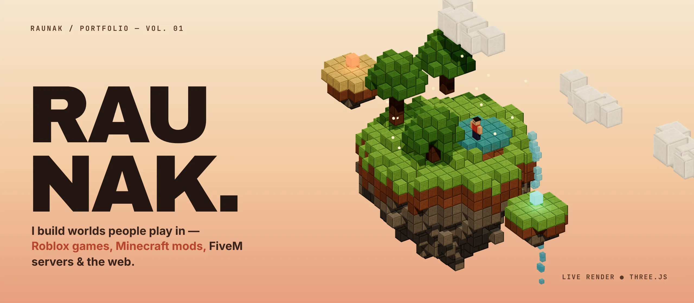
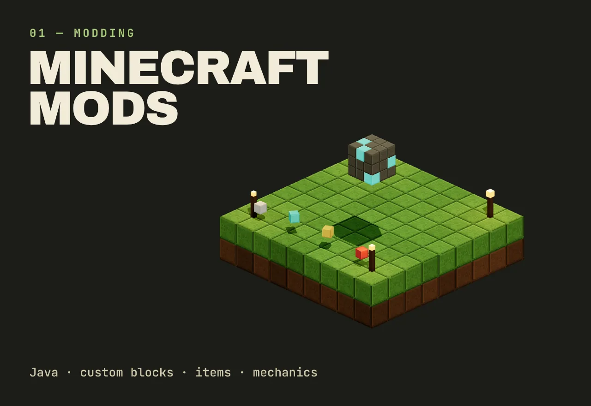
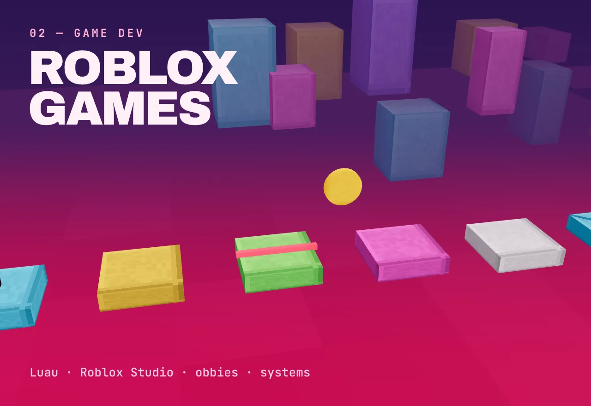
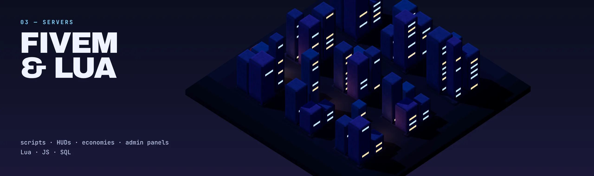

<table>
<tr>
<td width="50%"></td>
<td width="50%"></td>
</tr>
</table>

### Hey, I'm Raunak 👋

I make things people actually play: **Roblox games** in Luau, **Minecraft mods** in Java, and **FiveM servers** — scripts, HUDs, economies and admin panels. Outside the game world I build for the web and automate whatever I'm tired of doing by hand.

| Game worlds | Web & backend | Also |
| --- | --- | --- |
| Luau · Roblox Studio | Python · Django | C · C++ |
| Java · Minecraft modding | JavaScript · HTML · CSS | Automation |
| Lua · FiveM | SQL · MySQL · PostgreSQL | |

Every animation above is a real-time 3D scene I render with Three.js — source in <a href="scripts/render">scripts/render</a>.
